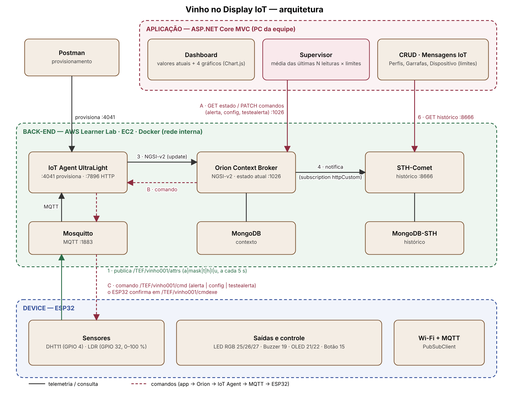

# Vinho no Display IoT

**Objetivo:** monitorar em tempo real a **temperatura, a umidade e a luminosidade** de uma adega de vinhos com um **ESP32**, guardar o histórico no FIWARE (STH-Comet + MongoDB) e **reagir a valores fora dos limites** com alertas visuais e sonoros. A aplicação web (ASP.NET Core MVC) mostra o painel, consulta o histórico, faz os cadastros e **supervisiona as médias**, enviando o comando de alerta ao ESP32. Tudo usa a API do FIWARE no AWS Learner Lab (nenhum banco local).

**Integrantes:**
- CAUÃ VECHINI LIMA (RA: 082250039)
- JULIANA MEDEIROS SILVA (RA: 082240040)
- LIVIA PEREIRA QUEIROZ (RA: 082240013)
- LUCAS PIOVEZAN DOS SANTOS (RA: 082250040)
- RAFAEL AKIO BUOSO WATANABLE (RA: 082240007)

## 1. Arquitetura

Padrão do FIWARE Made Simple: **a aplicação nunca fala direto com o ESP32.**

- **Dados (ESP32 → app):** o ESP32 publica `a|máscara|t|..|h|..|l|..|u|..` em `/TEF/vinho001/attrs` (MQTT :1883) a cada 5 s → o IoT Agent converte → **Orion** guarda o estado atual (:1026) → uma *subscription* (`httpCustom`) notifica o **STH-Comet** (:8666), que grava o histórico no **MongoDB-STH**. A aplicação lê o estado atual no Orion e o histórico no STH-Comet.
- **Comandos (app → ESP32):** o supervisor faz `PATCH` do comando `alerta` no Orion → o Orion repassa ao IoT Agent → publica em `/TEF/vinho001/cmd` → o ESP32 executa e confirma em `/cmdexe`; o atributo `alarm` volta como "eco" nas próximas leituras.
- O atributo `uptime` muda a cada mensagem: é o "sinal de vida" (status Online) e faz o Orion notificar o histórico mesmo quando os valores não mudam.

## 2. Componentes e pinagem

| Componente | Pino do ESP32 | Observação |
|---|---|---|
| Sensor DHT11 (temperatura e umidade) | GPIO 4 | VCC em 3V3. **No Wokwi usa-se o DHT22** (não há DHT11) |
| LDR (módulo, saída analógica) | GPIO 32 (ADC1) | ADC 12 bits (0–4095) → **0–100 %** (0 = escuro). `LDR_INVERTIDO` se o módulo ler ao contrário |
| LED RGB cátodo comum | GPIO 25 (R), 26 (G), 27 (B) | resistores de 220 Ω; comum no GND |
| Buzzer | GPIO 19 | PWM (`ledc`) para gerar os tons |
| Display OLED SSD1306 128×64 (I2C) | SDA 21, SCL 22 | faixa amarela = 16 primeiras linhas (módulo bicolor) |
| Botão (um só) | GPIO 15 → GND | `INPUT_PULLUP` |

## 3. Limites e supervisão

Os limites padrão (guarda de tintos) são **12–18 °C**, **60–75 %** de umidade e luz máxima de **30 %**. Eles ficam gravados no ESP32 e são alterados pela aplicação (tela *Dispositivo* ou *Perfis → Aplicar no dispositivo*) com o comando `config`.

**Janela de média:** a aplicação calcula a média das **últimas 6 leituras** (≈ 30 s, pois o ESP32 envia a cada 5 s), a cada 10 s. Parâmetros no `appsettings.json` (seção `Supervisao`). Para a demonstração, `JanelaLeituras: 3` deixa a reação mais rápida (≈ 15 s). A média evita que um pico isolado dispare o alerta.

O supervisor só envia comando quando o alerta exigido pela média **difere** do que o ESP32 informa em `alarm` (reenvia após 30 s se ele não refletir). Sem leituras recentes (< 60 s) não envia nada.

## 4. Tabela de alertas (condição → LED → buzzer)

| Condição (média fora do limite) | LED RGB piscando | Buzzer |
|---|---|---|
| **Temperatura** | **vermelho**, rápido (400 ms) | **1000 Hz** |
| **Umidade** | **azul**, médio (800 ms) | **1500 Hz** |
| **Luminosidade** | **amarelo**, lento (1600 ms) | **2200 Hz** |
| Falha do sensor DHT (detectada no ESP32) | magenta (800 ms) | sem som |
| **Normalidade** (as três dentro dos limites) | **desligado** | **desligado** |

- **Prioridade** com mais de uma anomalia: **temperatura > umidade > luminosidade** (a temperatura é o que mais estraga o vinho). O display lista todas as causas.
- O buzzer soa só na fase "LED aceso" do pisca. **Toque longo no botão (≥ 1,2 s) silencia o buzzer**; um novo alerta volta a soar.
- No display, ao entrar em alerta, a **faixa amarela** pisca com texto rolando por 4 s.

## 5. Display e botão

O **botão** (toque curto) troca entre 4 telas: temperatura, umidade, luminosidade e sistema. Cada tela mostra uma grandeza, a faixa ideal, "OK/ALERTA" e a hora (NTP, UTC-3) na faixa amarela. A animação inicial do projeto original (garrafa servindo a taça e "Vinho no display") foi mantida.

## 6. Estrutura do repositório

| Pasta | Conteúdo |
|---|---|
| `web/VinhoNoDisplay` | Front-end ASP.NET Core MVC (.NET 8): Dashboard, Mensagens IoT, Dispositivo, Perfis e Garrafas (CRUD), `SupervisorService` |
| `firmware/VinhoNoDisplay` | Sketch do ESP32 **real** (DHT11) |
| `wokwi/` | `diagram.json`, `sketch.ino` (DHT22, só para simular), `libraries.txt` |
| `fiware/` | Coleção do Postman **completa** (não depende da coleção da Smart Lamp) |
| `docs/` | `PASSO_A_PASSO.md`, `VALIDACAO_E_DECISOES.md`, diagrama |

## 7. Deploy no AWS Learner Lab (resumo; detalhes em `docs/PASSO_A_PASSO.md`)

1. Inicie a sessão do Learner Lab e crie/ligue a EC2 (Ubuntu x86_64, `t3.small`).
2. **Security Group** — libere só o necessário: **22** (SSH), **1026** (Orion), **8666** (STH-Comet), **1883** (MQTT), **4041** (provisionamento pelo Postman) e, apenas para simular sem hardware, **7896**.
3. Na EC2: `git clone https://github.com/fabiocabrini/fiware-made-simple.git`, depois `cd fiware-made-simple && ./scripts/check-requirements.sh && docker compose up -d --wait` (stack do professor, sem alterações).
4. No Postman, importe `fiware/Vinho_no_Display.postman_collection.json`, ajuste `host` e rode na ordem: **0** (Health) → **1.0 a 1.7** (service group se faltar, dispositivo, 4 subscriptions). Faça isso **antes** de ligar o ESP32.
5. **O IP público muda a cada sessão.** Atualize: a variável `host` do Postman; o IP do ESP32 (digite `broker IP` no Serial Monitor, sem regravar); e o IP no app (tela *Dispositivo → Servidor FIWARE*).

## 8. Como executar

- **ESP32 real:** Arduino IDE + placa ESP32 + bibliotecas *Adafruit GFX*, *Adafruit SSD1306*, *DHT sensor library*, *PubSubClient*. Abra `firmware/VinhoNoDisplay/VinhoNoDisplay.ino`, ajuste `WIFI_SSID`, `WIFI_PASS` e `BROKER_MQTT` e grave.
- **Wokwi:** crie um projeto ESP32 e cole `wokwi/diagram.json`, `wokwi/sketch.ino` e `wokwi/libraries.txt`. O simulador é lento (≈ 4 % da velocidade): o primeiro dado pode levar alguns minutos.
- **Aplicação:** instale o .NET 8 SDK, ajuste `Fiware:Host` em `web/VinhoNoDisplay/appsettings.json` e rode `dotnet run` em `web/VinhoNoDisplay`. A aplicação precisa estar **rodando** para o supervisor enviar os alertas.

## 9. Roteiro para provocar cada alerta (hands-on)

Com a aplicação aberta e o ESP32 publicando, mude o valor do sensor (no Wokwi, clique no DHT22/LDR e mova os controles) e aguarde a janela de média:

1. **Temperatura:** leve acima de 18 °C → LED vermelho rápido + 1000 Hz + faixa amarela piscando.
2. **Umidade:** leve acima de 75 % → LED azul + 1500 Hz.
3. **Luz:** aumente a luminosidade acima de 30 % → LED amarelo lento + 2200 Hz.
4. **Mais de uma:** temperatura e umidade juntas → vale a temperatura (vermelho/1000 Hz).
5. **Normalidade:** volte os valores → LED e buzzer desligam.
6. Atalho sem esperar a média: Postman **3.4 a 3.7** (`alerta|1/2/4/0`) ou o botão *Testar alerta* na tela *Dispositivo*.

## 10. Itens da rubrica

| Critério | Onde |
|---|---|
| H1 Device e sensores | `firmware/`, seção 2 |
| H2 Plataforma FIWARE | seção 7, `fiware/` |
| H3 Dashboard em tempo real | tela *Painel* (atualiza a cada 5 s, sem recarregar) |
| H4 Histórico | gráficos do painel e *Mensagens IoT* (API do STH-Comet) |
| H5 Triggers e alertas | `Services/SupervisorService.cs`, seções 3 e 4 |
| D2 Diagrama | seção 1 |
| D3 / D4 Códigos comentados | `VinhoNoDisplay.ino` / `web/VinhoNoDisplay` |

## 11. Limitações conhecidas

O OLED do Wokwi não mostra o amarelo; comandos não são reenviados pelo IoT Agent se o ESP32 estiver offline (o supervisor reenvia); o app não tem login; sem a aplicação rodando não há alerta (o ESP32 não decide sozinho).

## Checklist para uma nova instância (dia da apresentação)

1. Iniciar o Learner Lab, ligar a EC2 e anotar o **novo IP público**.
2. Conferir o Security Group (22, 1026, 8666, 1883, 4041; 7896 opcional).
3. Na EC2: `cd fiware-made-simple && docker compose up -d --wait` e `docker ps` (7 containers *healthy*).
4. Postman: atualizar a variável `host`; rodar **0.1 a 0.3**, **1.0** (se já houver service group `TEF`, pular o 1.1), **1.2** (201), **1.2b** (`count: 1`), **1.3 a 1.6** e **1.7** (4 subscriptions).
5. ESP32 físico: no Serial Monitor, `broker <IP>` (ou regravar `BROKER_MQTT`); Wi-Fi 2,4 GHz configurado em `WIFI_SSID`/`WIFI_PASS`.
6. **Só então** ligar o ESP32. Conferir `MQTT conectado` e, no Postman, o **3.3** com `temperature`, `humidity`, `luminosity`.
7. App: `dotnet run`, informar o IP em *Dispositivo → Servidor FIWARE*, clicar em *Criar perfis sugeridos* e cadastrar uma garrafa (a instância nova está vazia).
8. Ensaio: **3.4** (`alerta|1`) e **3.7** (`alerta|0`).

> O 1.2 precisa conter `"apikey": "TEF"`. Sem isso o IoT Agent cria um segundo dispositivo (`Thing:vinho001`) e as leituras não chegam em `urn:ngsi-ld:Vinho:001`.
